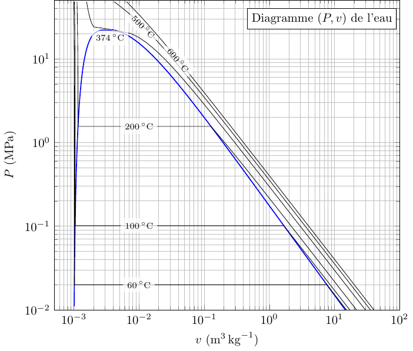
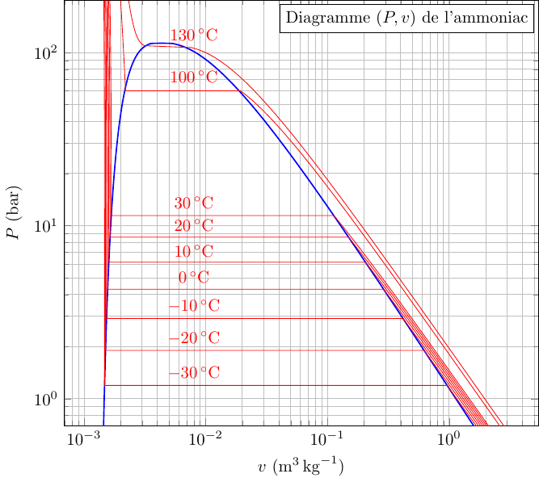

Les données utilisées ont été extraites du [NIST Chemistry WebBook](https://webbook.nist.gov/chemistry/fluid/), une base de données regroupant de nombreuses propriétés physico-chimiques. Leur récupération a été automatisée à l'aide d'un script Python.

Par exemple, le script suivant permet de récupérer les isothermes pour six températures différentes pour de l'eau. Les données sont enregistrées dans un fichier `.txt` :

``` python
import requests
import numpy as np

Temp = [-30, -20, -10, 0, 20, 30] # Liste de température

for T in Temp:
    # Interrogation de site NIST et récupération de la table isotherme
    url = f'https://webbook.nist.gov/cgi/fluid.cgi?Action=Data&Wide=on&ID=C7732185&Type=IsoTherm&Digits=5&PLow=0.1&PHigh=200&PInc=0.1&T={T}&RefState=DEF&TUnit=C&PUnit=bar&DUnit=kg%2Fm3&HUnit=kJ%2Fkg&WUnit=m%2Fs&VisUnit=uPa*s&STUnit=N%2Fm'
    r = requests.get(url, allow_redirects=True)
    open( f'isotherme_T={T}.txt', 'wb').write(r.content)
```

## Eau ($\mathrm{H_2O}$)

[Télécharger les données associées](data_pv_eau.zip)

{fig-align="center" width="335"}

``` tex

```

## Ammoniac ($\mathrm{NH_3}$)

[Télécharger les données associées](dataNH3.zip)

{fig-align="center" width="335"}

``` tex

```
